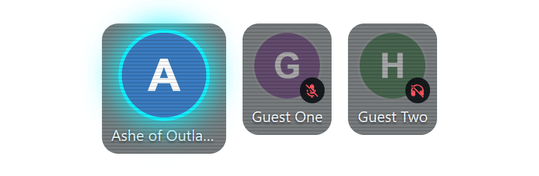

# Greenroom

**VDO.ninja guest dock + Discord voice roster for OBS, driven by Streamer.bot.**

Four swappable guest camera slots that follow your guests by *name* — when
someone's connection drops and they rejoin VDO.ninja with a fresh stream ID,
their slot re-acquires them automatically within ~2.5 s. Plus a standalone
Discord voice-channel overlay (the StreamKit-style roster, rebuilt): avatars
with a speaking glow, **mute/deaf badges**, streamer-first ordering, themeable
with CSS variables. A guest slot can also show a Discord user's avatar instead
of a camera — the "voice-only guest" placeholder that lights up when they talk.
A **guest directory** maps a VDO.ninja label and/or Discord user to an on-stream
display name + social handles, rendered as a **nameplate** (lower-third in the
slot, or a freely positioned standalone source) whenever that guest is live. It
**fills itself in**: anyone who joins the room or the voice channel is added with
a placeholder name (their label / Discord name) that you rename when you want
something better — searchable, one collapsed row per guest.



Streamer.bot is the entire backend: its WebSocket Server is the message bus, its
HTTP Server serves the pages, and five small pasted C# actions cache + rebroadcast
state. No always-on Node service. The only optional process is the Discord
bridge — a muted-but-listening discord.js bot that feeds real-time
speaking/mute/deaf state — and webcam-only setups never install it.

## How it works

```
control.html / director-min.html (browser — hosts a hidden vdo.ninja director
  iframe; resolves guest label → live streamID every 2.5 s)
        │ DoAction "VDO Push" (full state, pre-serialized)
        ▼
Streamer.bot ─ WS :8080 ── broadcasts vdoninja:update / discord:voice:update ──►
  actions: VDO Push · Discord Voice Push · VDO Sync · Discord Voice Command      │
  globals: vdo.state (persisted) · discord.state (non-persisted)                 │
        ▲ DoAction "Discord Voice Push"     ▲ commands back down the same bus    ▼
sidecar/discord-bridge.mjs (optional discord.js bot,          OBS Browser Sources:
  joins voice muted-but-listening, 100 ms coalesce)           guest slots ×4 + roster
```

Slots bind by VDO.ninja **label** (the stable key); stream IDs are volatile and
re-resolved continuously — that loop *is* the auto-follow feature. State lives in
Streamer.bot's global variables, so the control page can close and everything
still paints (every page replays state via the `VDO Sync` action on connect).

## Quick start

First, get the code onto the machine that runs Streamer.bot — either

```
git clone https://github.com/FlashGalatine/greenroom-guests.git
```

or click **<> Code → Download ZIP** on the repo page and extract it.

**A — webcam slots only (no Node, no installs):**
1. Follow [docs/STREAMERBOT-SETUP.md](docs/STREAMERBOT-SETUP.md): enable SB's
   WebSocket (:8080, auth off) + HTTP (:7474) servers, add two Path → Folder maps
   (Path `greenroom-control` → this repo's `control` folder, Path `greenroom-overlay` →
   its `overlay` folder: every address below uses those two names), paste the 4 core
   actions (skip `Discord Bridge Start`). Start Streamer.bot before OBS. Servers on other ports:
   the setup guide's "Ports and addresses" (§1).
2. Add OBS Browser Sources:
   `http://127.0.0.1:7474/greenroom-overlay/vdoninja-guest.html?slot=1` (…2, 3, 4): the
   control page's per-slot **Copy** buttons give the exact URL. A slot is 1 to 4; any
   other `?slot=` shows nothing (and the browser console says why). In each of the four
   sources tick **Control audio via OBS** (it is off by default), and to hear guests yourself
   set the source's **Audio Monitoring** to **Monitor and Output** on a device that Desktop
   Audio does not capture. Add each slot source **once** and reuse it in other scenes with
   **Add Existing** or **Paste (Reference)**, never **Paste (Duplicate)** or a new source:
   every copy is one more full stream the guest's PC has to send.
3. **First run.** Open `http://127.0.0.1:7474/greenroom-control/control.html`, type your room +
   password and press **Save** (it asks to confirm only if `VDO Sync` has not answered: compile it first),
   tick **director enabled**, send the guest link from **Invite & Director Links**
   (each guest is asked for a display name), and when a guest is live pick them in a **Guest
   Slot** dropdown. Keep exactly one director running: a 1×1 source running `director-min.html`
   **in a scene that is always shown** (OBS may suspend a source that is not shown)
   is the recommended, set-and-forget one; tick "director-min.html is my always-on director" in
   the dock, which then only edits (it still connects its own hidden director, but only director-min follows guests).
   Not yet confirmed live (setup guide, §6). A second director page, the
   invite builder's Manage link included, does not own the room (docs/STREAMERBOT-SETUP.md, §4,
   which also explains the invite options and what each state of the pill means).
4. *(optional)* Give guests on-stream names + socials in **Nameplates & Guest
   Directory**. Guests who are live show up there on their own with a placeholder
   name (badged `auto`) — click a row to rename them and add social handles, or
   `×` to drop them (they stay out; "Un-ignore removed" undoes that). The search
   box filters by name, label, Discord ID or Discord username, and the **auto-add
   guests** tick turns the whole thing off. The lower-third appears in each slot
   automatically (`?nameplate=0` to hide); for a freely positioned plate add
   `…/greenroom-overlay/nameplate.html?slot=1` as its own source
   (docs/THEMING.md).

**B — add Discord voice (roster overlay + voice-only slots):**
1. `cd sidecar && npm install` (Node ≥ 22.12; if you start the bridge from Streamer.bot's
   `Discord Bridge Start` action, **restart Streamer.bot after installing Node**: it reads its
   PATH only when it starts). The details of steps 1 to 3 are in
   [docs/STREAMERBOT-SETUP.md](docs/STREAMERBOT-SETUP.md), §5.
2. Create a bot (non-privileged Guilds + Guild Voice States intents) and **invite it to your
   server** (Developer Portal → OAuth2 → URL Generator: scope `bot`, permissions View Channels +
   Connect). Paste its token into `sidecar/discord-tokens.json`, shaped
   `{ "botToken": "...", "enabled": true }` — file-only, never enters the control page.
3. Run `start-discord-bridge.bat` (or the optional `Discord Bridge Start`
   action), add
   `http://127.0.0.1:7474/greenroom-overlay/discord-roster.html?layout=row` as a
   source. In the control page's Discord section put your own Discord user ID in **streamer id**
   (turn on Discord's Developer Mode to copy ids), save a favorite (Server ID + Voice Channel
   ID, a regular voice channel) with **Save favorite**, press **USE**, then **Connect**.
4. *(optional)* Tick **"leave call & quit when Streamer.bot closes"** in the
   control page so the bot hangs up and the sidecar exits when you close SB
   instead of lingering in the call (an SB restart reconnects and stays;
   docs/STREAMERBOT-SETUP.md).

Serve over `http://`, never as an OBS "Local file" — the VDO viewer renders
black in a `file://` parent and `file://` sources ignore URL params.

## Repo layout

```
control/    control.html (director + slot editor + invite builder + Discord section)
            director-min.html (1×1 always-on director) · vdo-parse.js (defensive parser)
            directory-core.js (guest-directory sanitizers + the auto-add rule, shared
              by both pages so the 1×1 director auto-populates on its own)
            vdo-url.js (the vdo.ninja URL rules: password encoding, view flags; an identical
              copy lives in overlay/)
            vdo-rev.js (rev / writer stamps and echo tracking for vdo.state, shared by both pages)
            sb-socket.js (opens both pages' Streamer.bot socket from a file, so a failed
              connect is logged with this file's address, not the page's ?sbpass)
overlay/    vdoninja-guest.html (?slot=N) · discord-roster.html (?layout=row|grid)
            nameplate.html (?slot=N standalone nameplate) · nameplate-shared.js
            panel-client-sb.js (SB transport shim) · vdo-url.js (copy of control/vdo-url.js)
actions/    the five Streamer.bot C# actions (paste + compile)
sidecar/    discord-bridge.mjs (optional discord.js bot) · its package.json
docs/       STREAMERBOT-SETUP.md · PROTOCOL.md · THEMING.md · screenshots
backup.mjs  snapshot/restore the SB dock config (room/slots/directory) to a file
mock-sb-server.mjs · mock-vdo-director.html · mock-discord-bridge.mjs
verify.mjs · verify-render.mjs · verify-cs.mjs · start-discord-bridge.bat
tools/      shots.mjs (the docs screenshots) · mutation/ (tests the tests) · cs-harness/ · sentinel.mjs · json-check.mjs
```

There are deliberately no per-slot HTML stubs: stubs only ever served OBS
"Local file" mode, which can't host the VDO viewer anyway — `?slot=N` covers it.

## Backups

The dock config — room, password, slots, invite, and the **guest directory /
nameplates** — lives only in Streamer.bot's persisted `vdo.state` global. Two ways
to keep a file copy:

- **In the control page:** the header's **Export config** / **Import config**
  buttons. Export downloads a JSON snapshot; Import loads one and re-pushes it to
  SB (so it persists like an edit — it *replaces* the current config). Inside an **OBS dock**
  the download may save silently (OBS 33) or not at all (OBS 32 and older): the page then shows
  the snapshot in a box in the Room & Director section, with a **Copy** button: copy it and save it in a file yourself.
- **CLI** (your real Streamer.bot must be running; it needs Node 22.12+ and a one-time `npm install --omit=dev` in this folder, which installs `ws`. The development mock is not a place to keep a backup):
  ```
  npm run backup                                   # → backups/vdo-state-<timestamp>.json
  npm run backup -- D:\safe\greenroom.json           # → that file (refused if it exists, unless --force)
  npm run backup:list
  npm run backup:restore -- backups/<file>         # check the snapshot, show current vs new; changes nothing
  npm run backup:restore -- backups/<file> --yes   # …and really replace the saved config
  ```
  `restore` checks the file the way the control page checks an import (a Greenroom snapshot, a text room,
  slots and a directory, Discord IDs in quotes, nothing from a newer Greenroom), saves the current config to
  `backups/pre-restore-<time>.json`, pushes the snapshot as a new write (with the slots' stream IDs blanked, since
  they were true on the day the file was saved: a running director puts the live ones back within a few seconds, so
  have the dock open, or the `director-min` source running), and says whether Streamer.bot confirmed it. `--force`
  accepts a raw `vdo.state` payload with no `kind` (and `save` over an existing file). A snapshot saved as UTF-16
  by Notepad or PowerShell is read too.
  Put flags after a `--` (npm swallows a bare `--url`; the tool refuses to run when it sees that):
  `npm run backup -- --url ws://127.0.0.1:8081/`. `SB_WS_URL` / `SB_WS_PORT` also point it at a non-default SB.

Snapshots contain the **room password**, so `backups/` is gitignored — treat the
files as secret. The Discord bot's favorites/settings are already file-based in
`sidecar/discord-voice-config.json` (copy it to back those up); the live voice
roster is intentionally not snapshotted.

## Updating

1. **Back up first** (Export config, or `npm run backup`), and read the CHANGELOG entries between your version and
   the new one: each lists what to copy, re-paste, restart or refresh.
2. **Stop the bridge**: press **Stop bridge** in the control page's Discord section (a bridge from the release that added
   `quit` onwards; it leaves the call and exits), otherwise end its `node.exe` in Task Manager (a hidden one that
   `Discord Bridge Start` launched too).
3. **Extract the new version over the old folder** (the download holds no `sidecar/discord-tokens.json`,
   `sidecar/discord-voice-config.json` or `backups/`, so extracting over the folder keeps them; an edited
   `start-discord-bridge.bat` is replaced, so put your options back). If you extract into a new folder instead, first
   copy those across (and any `vdo-state-*.json` backups lying in the root), point the Streamer.bot Path → Folder maps
   and `BUNDLE` at the new folder, and delete the old folder once it works: it still holds the token file and the backups.
4. Run `npm install` in `sidecar/` again (and in this folder once, `npm install --omit=dev`, for the backup CLI).
5. **Reload the dock and `director-min`, and refresh every Greenroom OBS source first** (a page that was loaded before
   the update keeps running the old code until it is reloaded), **then** re-paste: for the three state actions the
   order matters (setup guide, §2: an old page cannot read the new frames). **An overlay of your own that reads
   `vdoninja:update` or `discord:voice:update` straight from Streamer.bot** must read the string fields
   (`vdoninjaJson`, `discordVoiceJson`; docs/PROTOCOL.md) before you re-paste: the actions no longer send the nested
   `vdoninja` / `discordVoice` object, so an overlay that reads only that shows nothing afterwards.
6. **Re-paste the C# actions the CHANGELOG lists** and compile each. After re-pasting `Discord Bridge Start`,
   **set `BUNDLE` again** (the pasted code carries the placeholder; change only the `BUNDLE` line, never
   `BUNDLE_PLACEHOLDER` two lines below it) and put back what you had added to
   `psi.Arguments` (`--sb-ws-url`, `--guard-port`). The HTTP path maps and `BUNDLE` stay on the folder in use.
7. Start the bridge again.

## Verification (no Streamer.bot, Discord, or camera needed)

```
npm install          # root deps: ws (also used by the backup CLI) and playwright-core (dev, for verify:render)
npm --prefix sidecar ci   # the Discord bridge's dependencies; verify needs them for its sidecar sections
npm run verify       # checks: transport, both push round-trips (incl. the guest
                     # directory), persisted-vs-non-persisted restart semantics, the
                     # command bus, the REAL sidecar token-less over the bus, the
                     # exit-when-Streamer.bot-closes lifecycle (opt-in leave+quit vs
                     # default reconnect-forever), the backup CLI save+restore
                     # round-trip, malformed-guestList parser, the directory core
                     # (sanitizers + auto-add: fixpoint, order-independent, ignore
                     # list), HTTP serving + tripwires (incl. "no token string in
                     # control.html" and the director-min directory strip-guard)
npm run verify:render  # real-browser checks: guest slot URL assembly + the
                       # auto-follow REJOIN swap driven by a scripted fake director,
                       # nameplates (lower-third + standalone + rotator + hide rules),
                       # PFP glow, roster badges/order/hide + directory name override,
                       # a 20-user 100 ms burst, control page hydrate/edit/USE, and
                       # the directory UI (collapsed rows, search, auto-populate,
                       # rename-clears-auto, remove-stays-removed)
npm run verify:cs      # compiles the three state actions as shipped (the C# compiler
                       # that comes with .NET Framework 4, against mscorlib only) and
                       # runs them against a stub of Streamer.bot: every frame, the
                       # broadcast-before-cache order, the strict JSON check. Skips
                       # itself when no C# compiler is found. Set
                       # GREENROOM_NEWTONSOFT_DLL to Streamer.bot's Newtonsoft.Json.dll
                       # and it also re-parses each frame the way Streamer.bot does,
                       # which is what the date-shaped guest label checks need.
npm run mutation    # tests the tests: injects one deliberate bug at a time into a COPY of the repository and runs the suites against it
                       # (tools/mutation/README.md). Hours for the whole list, so it is not part of verify; `-- --check` takes a second.
npm run mock         # mock Streamer.bot (:7478 HTTP, :8084 WebSocket: never Streamer.bot's own ports) for hands-on dev;
                     # it refuses to start if either port is taken, and never uses Streamer.bot's own 7474 / 8080
npm run mock:bridge  # token-less fake Discord bridge (drives the roster live). It acts only on a server whose Hello says it is
                     # the mock; otherwise it sends no Subscribe or action and exits. To drive a REAL Streamer.bot on purpose: close the real bridge first,
                     # then (PowerShell)  $env:SB_WS_URL='ws://127.0.0.1:8080/'; npm run mock:bridge -- --allow-real-sb
                     #      (bash)        SB_WS_URL=ws://127.0.0.1:8080/ npm run mock:bridge -- --allow-real-sb
```

The C# in `actions/` is only text-checked by `npm run verify` (section [6]); where a .NET Framework C# compiler is found,
`npm run verify:cs` (the three state actions) and verify section [6b] (Discord Bridge Start and Discord Voice Command) also compile
it and run it against a stub of Streamer.bot. No suite compiles it inside Streamer.bot, and the mock never launches the bridge.

The mocks prove the protocol and the pixels; what only a live session can prove
(real vdo.ninja shapes, real bot voice handshake, the 100 ms coalesce floor, the
OBS-dock CEF question) was exercised on **2026-07-10** on a real Streamer.bot **1.0.4**
rig — including the OBS Custom Browser Dock running the director, a real-room
drop/rejoin auto-follow, and live Discord speaking events. Not exercised live: Streamer.bot's
action queue under a rowdy multi-speaker feed, the standalone 1×1 `director-min` source,
multi-director safety, guest audio. **Tested on:** Streamer.bot 1.0.4 with Greenroom 0.1.0 (live, that date). The checklist has
**not been re-run** on Streamer.bot 1.0.7 or OBS 33.0.1 (the action names and `CPH` calls were checked against 1.0.7
by name only); recheck it after a Streamer.bot or OBS major update, and 1.1.x (argument isolation) has not been
validated. Results: [docs/STREAMERBOT-SETUP.md](docs/STREAMERBOT-SETUP.md#6-live-validation-results-2026-07-10-real-streamerbot-104).

A **partial** live run on 2026-11-10 (Greenroom 1.0.104 on a spare Streamer.bot and OBS; versions and items at the end of that section) checked the fixes of that release and the HTTP `DoAction` request with Enforce on. It is not a re-run of the checklist.

## Security posture

Localhost trust: SB's WS can run with authentication off (the default) or on (see below), and the room password
travels in the broadcast payload because view URLs need it. The Discord bot
token never does — it lives only in the gitignored `sidecar/discord-tokens.json`,
and no bus command can read, carry or erase one (`verify` enforces that `control.html`
doesn't even contain the string, and that a token in the file appears in no frame,
state, log or config). Bus commands can still stop and move the bot, so don't expose
SB's servers beyond localhost. Deleting `discord-tokens.json` by hand forgets the token at the next Connect (or restart).

With authentication off, any page running in OBS, as a browser source or a dock,
or in a browser on the same PC can read the room password and drive Greenroom
through the WebSocket. Only add sources and docks you trust.

**Authentication plus Enforce** (recommended once every Greenroom piece is updated)
keeps anything that is not given the Streamer.bot WebSocket password off the
WebSocket. It does not keep
out your own OBS sources and docks, which are an unprompted route in: they carry the
password in their address (`?sbpass=<password>`, percent-encoded), and OBS stores a
source's address in the scene collection and a dock's in its own settings, so treat
both like the password. Enforce is what
breaks a Greenroom piece that has not been updated; Authentication alone does not.
The bridge keeps its copy in `sidecar/discord-tokens.json` (`"sbPassword"`, the only
place it keeps one) and `backup.mjs` uses `GREENROOM_SB_PASSWORD` or the same field.
Setup: docs/STREAMERBOT-SETUP.md, "Optional: Streamer.bot Authentication".

Authentication covers the WebSocket only. Streamer.bot's HTTP server, which Greenroom
needs to serve its pages, has no password setting, and Streamer.bot documents a
`DoAction` request on it that runs an action by its name. A run on Streamer.bot 1.0.7
on 2026-11-10 confirmed it: with Enforce on, the request ran `VDO Sync` without the
password. So a program on this PC,
or a page that can send requests to that server, can still run Greenroom's actions
with Enforce on: change what the guest slots and overlays show (`VDO Push`), or make
the Discord bot leave the call or quit (`Discord Voice Command`). Keep both servers
on 127.0.0.1 and load only sources, docks and pages you trust.

## Origins

Extracted from a personal streaming toolkit, where this ran as part of a bespoke
ControlPanel + relay-service stack; the port design is documented in that
repo's research notes (the director enumeration moved into the control page, the
bot became this sidecar, and Streamer.bot's WS replaced the relay). The
parts that carried over are the Discord error taxonomy, the BigInt
default-avatar math and the 100 ms coalesce. The voice rejoin (a backoff of 2, 5,
15 and 30 s, parked after Discord removes the bot from the call), the roster
reconcile after a gateway resume or re-identify, and the login retry are this
plugin's own.

## Author & support

Built by **Ashe "Flash" Galatine**.

- Email — [AsheJunius@gmail.com](mailto:AsheJunius@gmail.com)
- X — [@FlashGalatine](https://x.com/FlashGalatine) · BlueSky — [@projectgalatine.com](https://bsky.app/profile/projectgalatine.com)
- Twitch — [FlashGalatine](https://www.twitch.tv/FlashGalatine) · Discord — [Project Galatine](https://discord.gg/K6pRfSvu2Q)
- Support — Patreon [ProjectGalatine](https://www.patreon.com/ProjectGalatine) · CashApp [$ProjectGalatine](https://cash.app/$ProjectGalatine)

## Credits & license

MIT — see [LICENSE](LICENSE). Root runtime dependency is
[ws](https://github.com/websockets/ws) (MIT). The optional Discord bridge
sidecar depends on [discord.js](https://discord.js.org) +
[@discordjs/voice](https://github.com/discordjs/discord.js/tree/main/packages/voice)
(Apache-2.0) and [libsodium-wrappers](https://github.com/jedisct1/libsodium.js)
(ISC). The guest dock drives [VDO.ninja](https://vdo.ninja) via its public
IFrame API — nothing from VDO.ninja is vendored here. A few nameplate glyphs come
from other icon sets under their own licences: see
[THIRD_PARTY_NOTICES.md](THIRD_PARTY_NOTICES.md). Twitch, Discord, TikTok, X, Bluesky,
YouTube and Instagram are trademarks of their owners, shown only to say which service
a handle is on; Greenroom is not affiliated with or endorsed by any of them, nor by
Streamer.bot or VDO.ninja.
